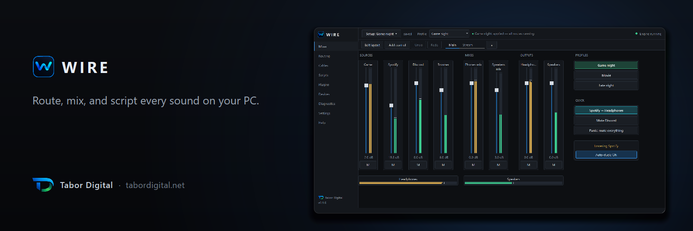
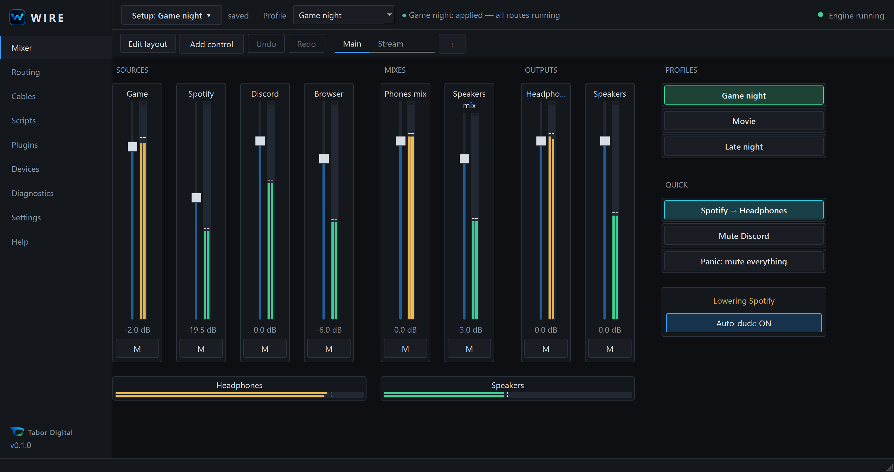
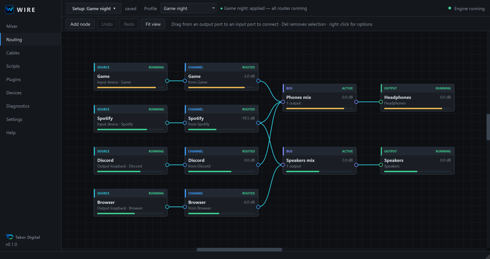
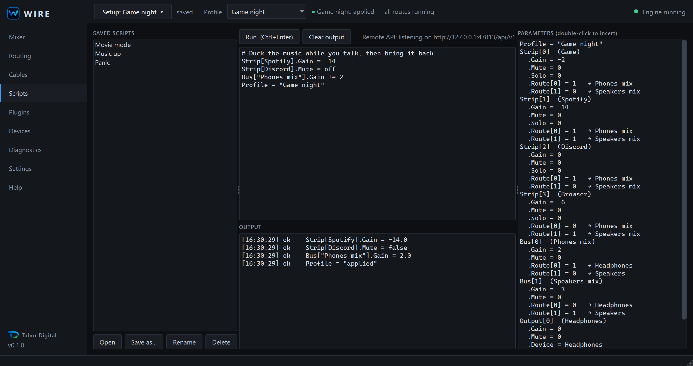

<p align="center">
  
</p>

# WIRE

A Windows audio router and mixer. Send your microphone, games, music, browser and chat apps to your headphones, speakers, or both at the same time. Build the mixer you want, draw your routing, and control it from scripts.

**Version 0.1.0** · Windows 10 and 11, x64 · Free · A young product

[**Download**](https://github.com/Tabor-Digital/wire/releases/latest) · [Website](https://tabordigital.net/products/wire/) · [Docs](https://tabordigital.net/docs/) · [Report a bug](https://github.com/Tabor-Digital/wire/issues/new/choose)

This repository holds the releases and the issue tracker for WIRE. The application source is not published here.

## Screenshots







## What works today

- Route and mix audio between microphones, games, music, browsers, chat apps and playback devices. Many inputs can play to many outputs at once.
- A visual node-graph routing page. Lines light up only when the audio engine confirms audio is flowing.
- A mixer page that starts empty. You build the layout from faders, buttons, meters and labels, with multiple pages, undo and redo. Everything is saved in one setup file.
- Routing and audio nodes: merge, switcher, selector, stereo split and join, mono, gain and pan, 6-band parametric EQ, compressor, limiter, noise gate, ducker and delay.
- Scripting and remote control: a small script language, a local HTTP API on `127.0.0.1` with a token, a command-line tool and a Python client.
- Python plugins, all disabled by default. One example plugin (auto-duck) is included.
- Profiles (for example Gaming, Movie, Late night) and setup files (`*.wiresetup`) that you can share by copying the file.
- Named, typed virtual cables (Input, Output, BiWIRE) with a guided setup wizard. These need Virtual Audio Cable, see below.
- Meters that show real engine levels, and plain-language error hints.
- A native C++ audio engine on WASAPI with clock-drift correction between devices and click-free changes. WIRE is a single standalone `WIRE.exe`.

A short script looks like this:

```
Strip[Spotify].Gain = -14
Strip[Discord].Mute = off
Bus["Phones mix"].Gain += 2
Node["Music to"].Position = next
Profile = "Game night"
```

## Not built yet

These are plans. There are no dates.

- Capturing audio per application, without virtual cables
- A signed installer and a code-signed exe
- Its own virtual audio driver

## Download

1. Open the [latest release](https://github.com/Tabor-Digital/wire/releases/latest) and download `WIRE.exe`.
2. Check the file against the SHA-256 hash in the release notes (see below).
3. Run `WIRE.exe`. There is no installer.

### Windows SmartScreen

`WIRE.exe` is not code-signed yet, so Windows SmartScreen may warn you the first time. This does not mean the file is damaged. It means Windows cannot confirm who published it. To run it after checking the hash, choose **More info**, then **Run anyway**.

### Verify your download

Open Command Prompt or PowerShell in the folder with the file.

```
certutil -hashfile WIRE.exe SHA256
```

```
Get-FileHash .\WIRE.exe -Algorithm SHA256
```

The result must match the hash in the release notes. If it does not, delete the file and download it again.

## Requirements

- Windows 10 or Windows 11, 64-bit
- At least one audio input or output device
- Optional: [Virtual Audio Cable](https://vac.muzychenko.net/en/download.htm), installed separately, for virtual cables

WIRE routes audio between devices without Virtual Audio Cable. VAC is a separate product by Eugene Muzychenko with its own licence. WIRE does not include or redistribute it, and Tabor Digital is not affiliated with its author. Check the VAC page for its current terms.

## Settings and uninstall

Settings are stored in your Windows AppData folder. WIRE does not need administrator rights. To uninstall, delete `WIRE.exe` and its settings folder.

## Privacy

WIRE makes no network requests except to its own local API on `127.0.0.1`. It sends no telemetry and has no accounts.

## Help and bug reports

- Start with [troubleshooting](https://tabordigital.net/docs/troubleshooting/).
- Then [open an issue](https://github.com/Tabor-Digital/wire/issues/new/choose). The form asks for your WIRE version, your Windows version and a copy of the Diagnostics page.
- Issues are public. Do not post tokens or other private data.

For security problems, see [SECURITY.md](SECURITY.md).

## Licence

The WIRE software is governed by the [End User Licence Agreement](https://tabordigital.net/legal/terms/). See [LICENSE](LICENSE). Third-party components and their licences are listed on the [credits page](https://tabordigital.net/legal/credits/).

Windows is a trademark of Microsoft. Voicemeeter is a product of VB-Audio Software. Other product names belong to their owners. Tabor Digital is not affiliated with them.
